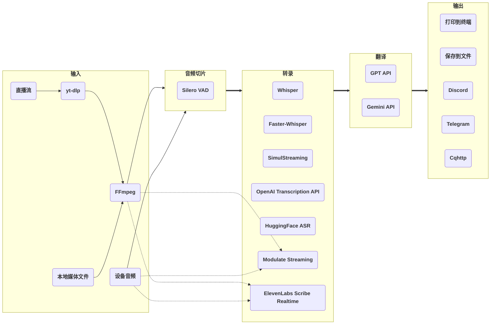

# stream-translator-gpt

[](https://badge.fury.io/py/stream-translator-gpt) [](https://pypi.org/project/stream-translator-gpt/) [](https://pepy.tech/project/stream-translator-gpt) [](https://github.com/ionic-bond/stream-translator-gpt/blob/main/LICENSE) [](https://gradio.app)

[**English**](./README.md) | **中文** | [**日本語**](./README_JP.md)

对直播流、本地媒体文件和设备音频进行实时转录和翻译。请通过命令行工具使用受支持的功能。旧版 Gradio WebUI 已弃用，不再维护或提供支持。

## 在 Colab 上快速开始（推荐）

最简单的使用方式：无需搭建本地环境，Colab 的性能足以稳定地日常使用，你只需要按用途准备自己的 API key：

- 使用 **Gemini API** 翻译：[创建 **Google API key**](https://aistudio.google.com/app/apikey)（推荐，Gemini 的 **Flash-Lite** 模型有每分钟 15 条、每日 500 条的免费额度）
- 使用 **OpenAI Transcription API** 转录或 **GPT API** 翻译：[创建 **OpenAI API key**](https://platform.openai.com/api-keys)（也可以使用任何 **OpenAI 兼容格式**的 API）
- 使用 **Modulate Multilingual Transcription — Streaming** 需要准备 [**Modulate API key**](https://docs.modulate.ai/guides/authentication)。
- 通过命令行使用 **ElevenLabs Scribe v2 Realtime** 需要准备 **ElevenLabs API key**。

|                                                                                            命令行                                                                                             |                                                                                         WebUI (deprecated)                                                                             |
| :-------------------------------------------------------------------------------------------------------------------------------------------------------------------------------------------: | :------------------------------------------------------------------------------------------------------------------------------------------------------------------------------------: |
| [](https://colab.research.google.com/github/ionic-bond/stream-translator-gpt/blob/main/colab/command_line_CN.ipynb) | [](https://colab.research.google.com/github/ionic-bond/stream-translator-gpt/blob/main/colab/webui_CN.ipynb) |

> [!NOTE]
> 由于 API key 被频繁爬取和盗用，我们无法提供试用 API key，请填写你自己的 API key。

## 工作原理



- **输入**：[**yt-dlp**](https://github.com/yt-dlp/yt-dlp) 从直播流中提取音频；也支持本地媒体文件和电脑设备音频。
- **音频切片**：基于 [**Silero-VAD**](https://github.com/snakers4/silero-vad) 的动态阈值切片。Modulate 流式后端会直接处理 16 kHz 音频流并绕过 VAD。 Scribe 同样接收连续音频，本地 VAD 仅决定 manual commit 的边界。
- **转录**：本地使用 [**Whisper**](https://github.com/openai/whisper) / [**Faster-Whisper**](https://github.com/SYSTRAN/faster-whisper) / [**SimulStreaming**](https://github.com/ufal/SimulStreaming) / [**HuggingFace ASR**](https://huggingface.co/models?pipeline_tag=automatic-speech-recognition)，或远程调用 [**OpenAI Transcription API**](https://platform.openai.com/docs/guides/speech-to-text) / [**Modulate Multilingual Transcription — Streaming**](https://docs.modulate.ai/api-reference/stt/streaming) / [**ElevenLabs Scribe v2 Realtime**](https://elevenlabs.io/docs/api-reference/speech-to-text/v-1-speech-to-text-realtime)。
- **翻译**（可选）：OpenAI 的 [**GPT API**](https://platform.openai.com/docs/overview) 或 Google 的 [**Gemini API**](https://ai.google.dev/gemini-api/docs)。
- **输出**：打印到**终端**、追加到 UTF-8 **文本文件**，或发送到 **Discord** / **Telegram** / **Cqhttp**。

## 本地安装（进阶）

本地运行需要一定的 Python 环境经验（Windows 下尤其如此），你实际上是在自己搭建一个与 Colab 类似的环境。拿不准的话，建议直接用 Colab。

1. **Python** >= 3.10
2. **FFmpeg**（已安装可跳过）：
   - Windows: `winget install ffmpeg`
   - Linux (Debian/Ubuntu): `sudo apt install ffmpeg`
3. 如需**本地转录**（Whisper / Faster-Whisper / SimulStreaming / HuggingFace ASR）时安装；只用 OpenAI Transcription API、Modulate Streaming 或 ElevenLabs Scribe 的话不需要：
   - [在系统上安装 **CUDA**](https://developer.nvidia.com/cuda-downloads)
   - [为 Python 安装 **PyTorch**（CUDA 版）](https://pytorch.org/get-started/locally/)
   - 如需使用 **Faster-Whisper**，[将 **cuDNN** 安装到 CUDA 目录](https://developer.nvidia.com/cudnn-downloads)

然后安装：

```
pip install stream-translator-gpt -U
```

如需同时安装不再受支持的旧版 WebUI：

```
pip install stream-translator-gpt[webui] -U
```

## 使用方法

### WebUI

> **自 2026-10-26 起弃用：** WebUI 不再维护或提供支持。保留原有入口和代码供已有用户使用，后续新功能仅支持命令行。

弃用记录：[弃用提交 `2f8f9d1f6e4b310e90f9f67a2ec2cd5072b78de9`](https://github.com/tqyaaaaang/stream-translator-gpt/commit/2f8f9d1f6e4b310e90f9f67a2ec2cd5072b78de9)；[弃用前最后基线 `62d3fafb26be196f9db6b7c4b46cea8b0d3657a8`](https://github.com/tqyaaaaang/stream-translator-gpt/tree/62d3fafb26be196f9db6b7c4b46cea8b0d3657a8)。

```
stream-translator-gpt-webui
```

启动时可以通过 `--ui-language` 指定 WebUI 界面语言，可选值为 `en`、`zh` 或 `ja`。

如需使用保留的旧版界面，在浏览器中打开输出的本地链接。现有配置仍可保存为预设，但不再维护与后续 CLI 变更的兼容性。

### 命令行

```
stream-translator-gpt URL [OPTIONS]
```

用 `--ss TIME` / `--to TIME` 指定处理区间，例如
`stream-translator-gpt recording.mp3 --ss 00:10:00 --to 00:12:00`，即处理两分钟。
语义与 FFmpeg 一致：`--to` 是原音视频中的绝对结束位置，不是持续时长。两个参数都可单独使用；
时间支持非负秒数或 `[HH:]MM:SS[.小数]`，秒数还可带 `s`、`ms`、`us` 后缀。
URL 使用 yt-dlp 的 FFmpeg 下载器。HLS/TS 默认快速 seek 到目标附近，可能存在分片级偏差，不保证误差在 10 秒以内。
添加 `--time-range-strict` 可让 HLS/TS 从头解码再可靠裁剪：需要读取前面的音频，启动可能更慢，
但不强制 1× 速度，也不会把裁剪前的音频发送给 API。其它可定位的文件和媒体直链在两种模式下都保留高效的索引 seek 和精确裁剪。
其它格式具体能跳过多少数据取决于服务器、媒体索引和直播 DVR 支持。
输出时间戳从所选区间的零点开始。设备输入或启用 `--live-from-start` 时会警告并忽略区间参数。
未指定 `--ss` 或 `--to` 时，`--time-range-strict` 会警告并忽略；`--pacer` 可独立使用。

**转录后端**（默认使用本地 **Whisper**）：

- ```stream-translator-gpt {网址} --language {输入语言}```
- **Faster-Whisper**: ```stream-translator-gpt {网址} --language {输入语言} --use-faster-whisper```
- **SimulStreaming**: ```stream-translator-gpt {网址} --language {输入语言} --use-simul-streaming```
- 以 **Faster-Whisper** 为编码器的 **SimulStreaming**: ```stream-translator-gpt {网址} --language {输入语言} --use-simul-streaming --use-faster-whisper```
- **OpenAI Transcription API**: ```stream-translator-gpt {网址} --language {输入语言} --use-openai-transcription-api --openai-api-key {你的 OpenAI key}```
- **Modulate Multilingual Transcription — Streaming**: ```stream-translator-gpt {网址} --use-modulate-transcription-api --modulate-api-key {你的 Modulate key}```
- **ElevenLabs Scribe v2 Realtime**: ```stream-translator-gpt {网址} --use-elevenlabs-scribe-api --elevenlabs-api-key {你的 ElevenLabs key}```
- **HuggingFace ASR** 模型（需要 `pip install stream-translator-gpt[hf_asr]`；仅支持 Hugging Face Hub 上 `pipeline_tag` 为 `automatic-speech-recognition` 的模型）: ```stream-translator-gpt {网址} --model {hf_模型名} --use-hf-asr```

Modulate 后端不使用 Silero VAD，而是把 16 kHz 音频直接发送给模型的流式模式；模型完成的每个 utterance 都会成为一个新句子。程序会持续监控 partial result：从当前未提交句子的第一个字（或切断时已存在的后续文字）开始计时，超过 `--modulate-partial-cutoff-seconds` 后，会在随后出现的第一个全角或半角标点处提交当前分段；句子之间的静音不会占用下一句的等待时间。对于 URL 直播流，Modulate 在直播边缘通常按音源速率发送；只要重连重放数据或实时输入队列中仍有积压，就会以最高 1.5 倍音源速率发送来追赶进度。发生意外传输中断时，程序会按指数退避重连；重连成功后，会重放上一个 final 结果之后收到的、最多 10 分钟音频。显式认证、额度和 API 错误不会重试。处理本地文件时，请使用实时播放，让超时判断与媒体时间一致：

```bash
stream-translator-gpt {文件路径} --pacer realtime --use-modulate-transcription-api --modulate-api-key {你的 Modulate key}
```

**ElevenLabs Scribe v2 Realtime（仅支持命令行）**

此后端固定使用 [`scribe_v2_realtime`](https://elevenlabs.io/docs/api-reference/speech-to-text/v-1-speech-to-text-realtime)、`commit_strategy=manual` 和 `include_timestamps=true`。通过 `--elevenlabs-api-key` 传入密钥，程序不会自动读取 key 文件。16 kHz 单声道 PCM 音频（包括静音）通过同一个 WebSocket 连续发送；本地 Silero VAD 继续使用现有 VAD 和音频长度参数决定何时发送 commit 标记，边界处不会重复发送音频。`--prefix-retention-length` 对此后端无效；`--max-audio-length` 超过 30 秒时会警告并限制为 30 秒。这些调整仅影响 Scribe 后端。

若 commit 区间不足 0.32 秒，会延后边界并继续接收音频，为服务端 0.3 秒的最小提交时长留出余量。EOF 时若尾段不足此长度，仅补充必要的静音；补充部分不计入源音频时长或字幕时间范围。该下限针对 commit 区间，不针对单个网络音频块。

`--pacer` 只控制 URL 和本地文件的输入速率。对于 URL 音源，Scribe 的 API 发送和断线重放另设 5 倍音频速度上限，与 `realtime` 或 `unlimited` 无关；没有积压时通常跟随音源速率。本地文件和设备不额外限制 Scribe API 发送速度：正常按输入供给发送，积压音频和断线重放则尽快发送。模型的实际处理速度可能变化。只有 committed 转录会进入现有过滤、翻译和输出流程，partial 不会作为最终结果输出。有逐词时间戳时会使用它们；API 可能返回 `words: null`，因此并非每段都有逐词对齐。

Scribe 在同一连接内自行保留上下文，manual commit 不会清空会话上下文。`--transcription-context` 对此后端不额外注入 `previous_text`，也不能关闭模型自身的会话上下文。

`--transcription-keywords` 会作为 Scribe `keyterms` 使用：按逗号分隔、去掉首尾空白和空项，结果为空时不传该参数。超过 50 项时会在 warning 中输出完整列表，然后只发送前 50 项；被选中的单项超过 20 个字符会报错。[ElevenLabs 关键词提示](https://elevenlabs.io/docs/eleven-api/guides/how-to/speech-to-text/batch/keyterm-prompting)会在基础转录费用上加收 20%。

```bash
stream-translator-gpt recording.mp3 --use-elevenlabs-scribe-api --elevenlabs-api-key "$ELEVENLABS_API_KEY" --language ja --pacer realtime
```

Modulate 和 Scribe 共用 `--transcribe-reconnect-attempts`（默认 `3`）与 `--transcribe-reconnect-backoff-seconds`（默认 `1.0`）。重连次数必须是非负整数，`0` 表示关闭自动重连；退避秒数必须是有限非负数，`0` 表示不延迟重试，其他值采用最高 30 秒的指数退避。旧参数 `--modulate-reconnect-attempts` 和 `--modulate-reconnect-backoff-seconds` 保留为已弃用别名，使用时会输出 warning。支持 `--flag value` 和 `--flag=value` 两种写法；混用新旧名称时，每项设置以最后出现的值为准。各后端原有的可重试错误范围和音频重放行为保持不变。

**翻译**（设置 `--translation-prompt` 即启用；根据填写的 API key 自动选择服务商）：

- 使用 **Gemini**: ```stream-translator-gpt {网址} --language {输入语言} --translation-prompt "把{输入语言}翻译成{输出语言}" --google-api-key {你的 Google key}```
- 使用 **GPT**: ```stream-translator-gpt {网址} --language {输入语言} --translation-prompt "把{输入语言}翻译成{输出语言}" --openai-api-key {你的 OpenAI key}```
- 同时使用 **OpenAI Transcription API** 和 **Gemini**: ```stream-translator-gpt {网址} --language {输入语言} --use-openai-transcription-api --openai-api-key {你的 OpenAI key} --translation-prompt "把{输入语言}翻译成{输出语言}" --google-api-key {你的 Google key}```

> [!TIP]
> 翻译 prompt 会原样传给大模型，所以它能承载的不只是语言对。如果你的 API 额度允许，把背景信息写进去（主播是谁、直播的内容是什么、专有名词希望怎么译等），翻译会更准确，也更能根据上下文纠正语音识别的错字。

**输入源**（除直播流网址外）：

- **本地视频/音频文件**: ```stream-translator-gpt {文件路径} --language {输入语言}```
- **系统音频**（即电脑正在播放的声音）: ```stream-translator-gpt device --language {输入语言}```
- **麦克风**: ```stream-translator-gpt device --mic --language {输入语言}```

**输出目标**（除终端外）：

- **Discord**: ```stream-translator-gpt {网址} --language {输入语言} --discord-webhook-url {你的 Discord webhook 地址}```
- **Telegram**: ```stream-translator-gpt {网址} --language {输入语言} --telegram-token {你的 Telegram 令牌} --telegram-chat-id {你的 Telegram 聊天 id}```
- **Cqhttp**: ```stream-translator-gpt {网址} --language {输入语言} --cqhttp-url {你的 Cqhttp 地址} --cqhttp-token {你的 Cqhttp 令牌}```
- **带时间戳的文本文件**：```stream-translator-gpt {网址} --language {输入语言} --translation-prompt "把{输入语言}翻译成{输出语言}" --google-api-key {你的 Google key} --no-show-transcribe-result --retry-if-translation-fails --output-file-path ./result.txt --output-file-timestamps```

### 项目目录

`stream_translator_gpt/` 按流水线阶段组织：`getter/` 获取音频，`slicer/` 做 VAD 与切片，
`transcriber/` 转录，`translator/` 翻译，`exporter/` 输出，`utils/` 提供共用辅助功能。
`main.py` 保留 CLI 和流水线组装。转录过滤器和 SimulStreaming 放在 `transcriber/` 内；
切片器的模型资源随 `slicer/` 打包。顶层独立的 `utils/term_utils.py` 及
`stream-translator-build-terms` 命令保持不变。

### 翻译模块职责

默认翻译实现将流水线生命周期（`translator/pipeline.py`）、调度与有序发布（`translator/scheduler.py`）、
请求工作线程循环（`translator/worker.py`）、供应商 API 调用（`translator/backends.py`）、线程独占的 client
（`translator/clients.py`）以及 prompt 构造与结果解析（`translator/protocol.py`）分别实现。
模块间通过 `translator/types.py` 定义的不可变请求和结果通信；只有调度器会修改流水线任务。
工作线程不会等待 context、输出顺序或重试退避。

`--use-old-translator` 选择 `translator/legacy/legacy_translator.py` 中从 `ab314cf` 原封不动保留的完整历史实现，
不导入或调用新翻译模块。其原有 client pool、重试、超时与退出方面的限制也保持不变：
context 模式串行，否则最多 10 个并发请求。`--translation-threads` 只影响新实现。

## 所有选项

> [!NOTE]
> 所有选项的横杠和下划线写法等价：`--openai-api-key` 与 `--openai_api_key` 相同。
> 每个布尔选项都有对应的 `--no-*` 反向形式用于关闭（例如默认开启的 `--dynamic-vad-threshold` 可以用 `--no-dynamic-vad-threshold` 关闭）。

| 选项                               | 默认值                         | 描述                                                                                                                                                                          |
| :--------------------------------- | :----------------------------- | :---------------------------------------------------------------------------------------------------------------------------------------------------------------------------- |
| `URL`                              |                                | 直播流的 URL。如果填入本地文件路径，则会将其用作输入。如果填入 "device"，将从你的电脑设备获取输入。                                                                           |
| **通用选项**                       |
| `--openai-api-key`                 |                                | GPT 翻译使用的 OpenAI API key；未设置 `--whisper-api-key` 时也作为远程转录的后备 key。多个 key 可用 "," 分隔并轮流使用。                                                       |
| `--whisper-api-key`                |                                | Whisper 兼容转录端点使用的 API key，会覆盖远程转录使用的 `--openai-api-key`。多个 key 可用 "," 分隔并轮流使用。                                                               |
| `--modulate-api-key`               |                                | Modulate Multilingual Transcription — Streaming 使用的 API key；启用 `--use-modulate-transcription-api` 时必须设置。                                                        |
| `--elevenlabs-api-key` | | ElevenLabs Scribe v2 Realtime 的 API key。启用 `--use-elevenlabs-scribe-api` 时必填，不会自动读取 key 文件。 |
| `--google-api-key`                 |                                | 使用 Gemini 翻译时需要的 Google API key。如果有多个 key，可用 "," 分隔，每个 key 会轮流使用。                                                                                 |
| `--openai-base-url`                |                                | 自定义 GPT 翻译使用的 OpenAI API 端点；未设置 `--whisper-base-url` 时也作为远程转录的后备端点。                                                                                |
| `--whisper-base-url`               |                                | 自定义 Whisper 兼容转录 API 使用的端点。                                                                                                                                       |
| `--google-base-url`                |                                | 自定义 Google 的 API 端点（影响 Gemini 翻译）。                                                                                                                               |
| `--no-verify-ssl`                  |                                | 禁用 OpenAI / Google API 及 HuggingFace 下载的 TLS 证书校验。当你的 API 端点或代理使用自签名或无效证书时使用。如果 base URL 的主机是裸 IP，会自动禁用校验。                   |
| `--proxy`                          |                                | 为所有未单独设置的 --*-proxy 选项统一设置代理。同时会设置 http_proxy 环境变量。                                                                                               |
| **输入选项**                       |
| `--format`                         | ba/wa*                         | 流格式代码，此参数会直接传给 yt-dlp。可通过 `yt-dlp {url} -F` 获取可用格式列表。                                                                                              |
| `--list-format`                    |                                | 打印所有可用格式后退出。                                                                                                                                                      |
| `--cookies`                        |                                | 用于打开会员限定直播，此参数会直接传给 yt-dlp。                                                                                                                               |
| `--input-proxy`                    |                                | 为 yt-dlp 指定 HTTP/HTTPS/SOCKS 代理，例如 http://127.0.0.1:7890。                                                                                                            |
| `--wait-for-video [秒数]`          | 默认关闭；裸参数为 60          | 等待计划直播开始。该值是 yt-dlp 两次可用性检查之间的最短间隔；如果开播时间已知，yt-dlp 可能直接等待到该时间。不传时关闭等待，裸参数使用 60 秒。                               |
| `--live-from-start`                | False                          | 请求 yt-dlp 从受支持直播的开头开始下载，而不是从当前直播位置开始。该 yt-dlp 功能仍属实验性功能，且仅适用于实现了它的提取器。                                               |
| `--ss TIME`                       | 默认关闭                       | 本地文件或 URL 的起始位置；支持非负秒数或 `[HH:]MM:SS[.小数]`。设备输入或 `--live-from-start` 下警告并忽略。 |
| `--to TIME`                       | 默认关闭                       | 原音视频中的绝对结束位置，不是时长；必须大于 `--ss`（未设置时为零）。设备输入或 `--live-from-start` 下警告并忽略。 |
| `--time-range-strict`             | 默认关闭                       | HLS/TS 从头解码再可靠裁剪，代替可能有分片级偏差的快速 seek；需要读取前面的音频。未指定 `--ss` / `--to`、设备输入或 `--live-from-start` 下警告并忽略。 |
| `--stream-format-diagnostic-file PATH` | 默认关闭                  | 让 yt-dlp 将所选流格式的白名单元数据写入用户指定路径，并在每条流开始时替换该文件。仅显式传入时启用；未指定时绝不会创建隐式诊断文件。                                      |
| `--pacer`                          | unlimited                      | URL 流和本地文件的输入速率限制：`unlimited` 按下游处理能力尽快读取，`realtime` 按墙钟时间每秒输出一秒解码音频。设备输入本身已是实时采集，指定非默认值时会警告并忽略。 仅 URL 音源的 Scribe API 发送和断线重放另设 5 倍速度上限，与此设置无关。本地文件和设备的 Scribe 发送（包括重放）不额外限速。 |
| `--device-index`                   |                                | 需要录制的设备编号。不设置时使用系统默认录音设备。                                                                                                                            |
| `--list-devices`                   |                                | 打印所有音频设备信息后退出。                                                                                                                                                  |
| `--device-recording-interval`      | 0.5                            | 录制间隔越短延迟越低，但会增加 CPU 占用。建议设置在 0.1 到 1.0 之间。                                                                                                         |
| `--device-audio-getter`            | pyaudio                        | 选择 `pyaudio` 或手动 `sounddevice` 后备。SoundDevice 只能捕获可输入设备；如需系统音频，请用 `--device-index` 选择 monitor、stereo-mix 或虚拟输入设备。                            |
| `--device-multiplier`              | 1.0                            | 两种设备音频获取器均支持的旧版感知音量因子；1 表示保持原始振幅。                                                                                                              |
| `--device-audio-debug-dir`          |                                | 将处理后的设备输入保存为数量受限的单声道 16 kHz PCM WAV 片段；默认关闭。                                                                                                      |
| `--device-audio-debug-clip-duration` | 10.0                           | 每个设备调试 WAV 片段的时长（秒）。                                                                                                                                           |
| `--device-audio-debug-max-clips`    | 10                             | 单次运行最多写入的设备调试 WAV 片段数。                                                                                                                                        |
| `--mic`                            |                                | 使用麦克风代替系统音频（电脑正在播放的声音）作为输入。                                                                                                                        |
| **音频切片选项**                   |
| `--min-audio-length`               | 0.5                            | 音频切片的最小长度（秒）。                                                                                                                                                    |
| `--max-audio-length`               | 30.0                           | 音频切片的最大长度（秒）。 仅 Scribe 后端会将超过 30 秒的值警告并限制为 30 秒。 |
| `--target-audio-length`            | 5.0                            | 启用动态静音阈值时（默认开启），程序会尽量将音频切成接近此长度的片段。                                                                                                        |
| `--continuous-no-speech-threshold` | 1.0                            | 持续无语音达到此秒数时切片。启用动态静音阈值时（默认开启），实际阈值会基于此值动态调整。                                                                                      |
| `--no-dynamic-no-speech-threshold` |                                | 禁用动态静音阈值（默认开启）。                                                                                                                                                |
| `--prefix-retention-length`        | 0.5                            | 切片时保留的前缀音频长度。 对 Scribe 无效；它连续发送音频，不保留重叠前缀。 |
| `--vad-threshold`                  | 0.35                           | 范围 0~1。此值越高，语音判定越严格。启用动态 VAD 阈值时（默认开启），阈值会基于此值动态调整。                                                                                 |
| `--no-dynamic-vad-threshold`       |                                | 禁用动态 VAD 阈值（默认开启）。                                                                                                                                               |
| **转录选项**                       |
| `--model`                          | turbo                          | 选择 Whisper/Faster-Whisper/SimulStreaming 的模型大小。可用模型参见[此处](https://github.com/openai/whisper#available-models-and-languages)。                                 |
| `--language`                       | auto                           | 直播中使用的语言。默认自动检测。可用语言参见[此处](https://github.com/openai/whisper#available-models-and-languages)。                                                        |
| `--use-faster-whisper`             |                                | 使用 Faster-Whisper 代替 Whisper。与 --use-simul-streaming 同时使用时，将以 Faster-Whisper 为编码器运行 SimulStreaming。                                                      |
| `--use-simul-streaming`            |                                | 使用 SimulStreaming 代替 Whisper。与 --use-faster-whisper 同时使用时，将以 Faster-Whisper 为编码器运行 SimulStreaming。                                                       |
| `--use-openai-transcription-api`   |                                | 使用 OpenAI Transcription API 代替本地 Whisper。                                                                                                                              |
| `--use-modulate-transcription-api` |                                | 使用 Modulate Multilingual Transcription — Streaming，直接流式处理 16 kHz 音频并绕过 Silero VAD。                                                                            |
| `--use-elevenlabs-scribe-api` | | 使用 ElevenLabs Scribe v2 Realtime，由本地 VAD 手动 commit，并开启时间戳。仅支持命令行。 |
| `--modulate-partial-cutoff-seconds` | 10.0                           | 从当前未提交句子的第一个字开始超过该秒数后，在随后出现的第一个全角或半角标点处提交；此前的静音不计入等待时间。                                                                        |
| `--transcribe-reconnect-attempts` | 3 | Modulate 和 Scribe 的最大自动重连次数。必须是非负整数；`0` 关闭自动重连。 |
| `--transcribe-reconnect-backoff-seconds` | 1.0 | Modulate 和 Scribe 的首次重连等待秒数。必须是有限非负数；`0` 表示不延迟。指数退避最高 30 秒。 |
| `--modulate-reconnect-attempts` | | `--transcribe-reconnect-attempts` 的已弃用别名；使用时输出 warning，适用于两个流式后端。 |
| `--modulate-reconnect-backoff-seconds` | | `--transcribe-reconnect-backoff-seconds` 的已弃用别名；使用时输出 warning，适用于两个流式后端。 |
| `--modulate-websocket-compression` | False                          | 为 Modulate 启用 WebSocket per-message deflate。压缩可减少网络带宽，但会增加 CPU 开销；默认不压缩，更适合 CPU 资源紧张而网络条件较好的部署。                                  |
| `--openai-transcription-model`     | gpt-transcribe                 | OpenAI 转录模型。普通转录推荐使用 `gpt-transcribe`；也支持 `whisper-1`、`gpt-4o-mini-transcribe` 和 `gpt-4o-transcribe`。                                                     |
| `--use-hf-asr`                     |                                | 使用 HuggingFace ASR 模型，用 `--model` 指定模型 ID。需要 `pip install stream-translator-gpt[hf_asr]`。                                                                       |
| `--transcription-filters`          | emoji_filter,repetition_filter | 应用于转录结果的过滤器，用 "," 分隔。目前提供 emoji_filter 和 repetition_filter。                                                                                             |
| `--language-filters`               |                                | 启用指定语言的转录过滤器，用英文逗号分隔。支持 `en`/`english`、`ja`/`japanese` 和 `zh`/`chinese`（包括 `zh-cn`、`zh-tw`）等别名；不传时默认关闭。                                |
| `--transcription-keywords`         |                                | 逗号分隔的转录关键词。`gpt-transcribe` 会作为 `keywords` 发送，其他 Whisper 后端会作为初始 prompt 使用。旧的 `--transcription-initial-prompt` 仍可用，但已弃用。 Scribe 使用 `keyterms`：去空项，超过 50 项时 warning 完整列表后取前 50 项，单项超过 20 字符报错；非空关键词会产生 API 附加费用。 |
| `--transcription-context`          |                                | 启用转录中的上下文传递，只保留上一条结果；SimulStreaming 和 HuggingFace ASR 不支持文本上下文（默认关闭）。 Scribe 不使用此开关，其连接内上下文由模型管理。 |
| **翻译选项**                       |
| `--gpt-model`                      | gpt-5.6-luna                   | OpenAI 的 GPT 模型名，gpt-5.4-nano / gpt-5.4-mini / gpt-5.6-luna / gpt-5.6-terra                                                                                              |
| `--openai-translation-api`         | auto                           | OpenAI 翻译 API 模式：auto / responses / chat-completions。`auto` 对 OpenAI 官方端点使用 Responses；设置 `--openai-base-url` 时使用 Chat Completions。若自定义端点实现了 `/v1/responses`，请显式选择 `responses`。 |
| `--gemini-model`                   | gemini-3.5-flash-lite          | Google 的 Gemini 模型名，gemini-3-flash-preview / gemini-3.1-flash-lite / gemini-3.5-flash / gemini-3.5-flash-lite / gemini-3.6-flash                                         |
| `--translation-prompt`             |                                | 设置后，将通过 GPT / Gemini API 把结果文本翻译为目标语言（根据填写的 API key 自动选择）。示例："将日语翻译为中文"。在 prompt 中补充背景（主播是谁、直播内容）可提升翻译质量。输出格式由程序内部控制；该 prompt 只需描述翻译内容、术语、背景与风格。 |
| `--translation-history-size`       | 3                              | 每次请求的 `Reference` 包含的前文原始转录条数，必须大于等于 0。启用滚动 context 时，设为 0 通常会使请求串行执行。 |
| `--translation-threads`            | 3                              | 最大并发翻译请求数，必须至少为 1。请求动态分配给空闲线程，结果仍按原文顺序输出。启用滚动 context 且线程数大于 Reference 窗口 + 1 时给出 warning，但仍按配置运行。 |
| `--use-old-translator`             |                                | 应急回退到原封不动保留的完整历史翻译实现，并输出弃用 warning。旧实现忽略 `--translation-threads`，启用滚动 context 时仍串行执行。 |
| `--use-translation-context`        |                                | 维护不超过 100 个 Unicode 字符的内部摘要，保留较长期的主题、活动、实体和未解决状态。并发请求采用原时间顺序最新的可用 `Context` 和近期原始转录 `Reference`。Reference 无法覆盖缺口时等待；若已无在途或待重试任务能补足缺口，使用最新可用 context 继续，仅记录 INFO。Context 本身永不导出。 |
| `--translation-timeout`            | 10                             | 从该句首次派发开始的总时间限制（秒），包含重试和退避等待，过期结果会被丢弃。0 禁用总时间限制，但单次网络调用仍有超时。 |
| `--use-json-result`                |                                | 在 LLM 翻译中使用 JSON 结果，适用于某些本地部署的模型。                                                                                                                       |
| `--retry-if-translation-fails`     |                                | 在翻译总时间限制内重试失败请求，保持原 Reference/context 快照。搭配 `--translation-timeout 0` 时可能持续重试，直到手动停止。 |
| `--temperature`                    |                                | GPT/Gemini 参数。控制输出随机性，值越高结果越多样。                                                                                                                           |
| `--top-p`                          |                                | GPT/Gemini 参数。核采样阈值，只考虑累计概率超过此值的 token。                                                                                                                 |
| `--top-k`                          |                                | Gemini 参数。将 token 选择限制在概率最高的 K 个候选之内。                                                                                                                     |
| `--openai-prompt-cache`            |                                | 在 Responses 模式中选择启用 GPT-5.6 显式 prompt 缓存。缓存断点位于完整且稳定的系统指令之后；动态历史和当前转录文本位于断点之后。少于 1,024 tokens 的前缀不会被缓存，并会输出 warning。 |
| `--prompt-cache-key`               |                                | 可选的 prompt 缓存路由 key。未启用 `--openai-prompt-cache` 时仍会发送，以供隐式缓存路由；启用显式缓存时，它会覆盖根据模型和完整系统指令派生的稳定 key。                         |
| `--reasoning-effort`               | 自动（最低支持级别）           | GPT 参数。控制推理模型的推理深度。可选：none / minimal / low / medium / high / xhigh / max。                                                                                  |
| `--verbosity`                      |                                | GPT 参数。控制回复的详细程度。可选：low / medium / high。                                                                                                                     |
| `--service-tier`                   |                                | GPT 参数。指定处理优先级层级。可选：auto / default / flex / priority。                                                                                                        |
| `--debug-mode`                     |                                | 启用调试模式并在每次翻译调用后记录用量信息。完整 LLM prompt 仅在同时启用 `-vvv` 时记录。                                                                                         |
| `--processing-proxy`               |                                | 为 Whisper/GPT API 指定 HTTP/HTTPS/SOCKS 代理（Gemini 目前不支持在程序内指定代理），例如 http://127.0.0.1:7890。                                                              |
| **输出选项**                       |
| `--output-timestamps`              |                                | 在控制台和非文件导出渠道中输出时间戳，不影响输出文件。                                                                                                                                        |
| `--no-show-transcribe-result`      |                                | 隐藏转录结果（默认显示）。                                                                                                                                                    |
| `--output-file-path`               |                                | 将结果文本以 UTF-8 编码追加到此文件，并保留已有内容。                                                                                                                                       |
| `--output-file-timestamps`         |                                | 分别为文件中的每行转录和翻译添加开始时间戳，格式为 `[开始时间戳] 文本`；不输出结束时间戳。                                                                                                            |
| `--cqhttp-url`                     |                                | 设置后，结果文本将发送到此 Cqhttp 服务器。                                                                                                                                    |
| `--cqhttp-token`                   |                                | Cqhttp 的 Token，服务器端未设置的话无需填写。                                                                                                                                 |
| `--discord-webhook-url`            |                                | 设置后，结果文本将发送到此 Discord 频道。                                                                                                                                     |
| `--telegram-token`                 |                                | Telegram 机器人的 Token。                                                                                                                                                     |
| `--telegram-chat-id`               |                                | 设置后，结果文本将发送到此 Telegram 聊天。需要与 --telegram-token 配合使用。                                                                                                  |
| `--output-proxy`                   |                                | 为 Cqhttp/Discord/Telegram 指定 HTTP/HTTPS/SOCKS 代理，例如 http://127.0.0.1:7890。                                                                                           |

## 联系我

Telegram: [@ionic_bond](https://t.me/ionic_bond)

## 捐赠

[PayPal 捐赠](https://www.paypal.com/donate/?hosted_button_id=D5DRBK9BL6DUA) 或 [PayPal](https://paypal.me/ionicbond3)
