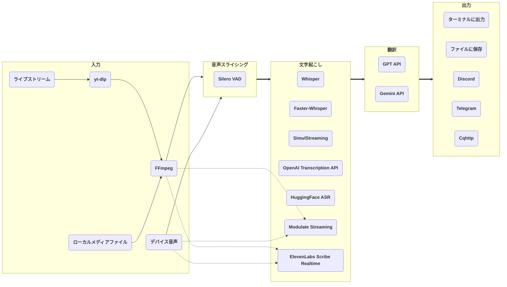

# stream-translator-gpt

[](https://badge.fury.io/py/stream-translator-gpt) [](https://pypi.org/project/stream-translator-gpt/) [](https://pepy.tech/project/stream-translator-gpt) [](https://github.com/ionic-bond/stream-translator-gpt/blob/main/LICENSE) [](https://gradio.app)

[**English**](./README.md) | [**中文**](./README_CN.md) | **日本語**

ライブストリーム・ローカルメディアファイル・デバイス音声のリアルタイム文字起こしと翻訳。サポート対象の機能はコマンドラインツールから利用してください。従来の Gradio WebUI は非推奨となり、保守・サポートを終了しました。

## Colab でクイックスタート（推奨）

最も簡単な使い方です。ローカル環境の構築は不要で、Colab の性能で日常的に安定して使えます。必要なのは、使うサービスに応じた自分の API キーだけです：

- **Gemini API** で翻訳する場合：[**Google API** キーを作成](https://aistudio.google.com/app/apikey)（おすすめ。Gemini の **Flash-Lite** モデルには毎分 15 回・毎日 500 回の無料枠があります）
- **OpenAI Transcription API** で文字起こし、または **GPT API** で翻訳する場合：[**OpenAI API** キーを作成](https://platform.openai.com/api-keys)（**OpenAI 互換の API** も利用できます）
- **Modulate Multilingual Transcription — Streaming** を使うには [**Modulate API キー**](https://docs.modulate.ai/guides/authentication)が必要です。
- コマンドラインで **ElevenLabs Scribe v2 Realtime** を使うには **ElevenLabs API キー**が必要です。

|                                                                                        コマンドライン                                                                                         |                                                                                         WebUI (deprecated)                                                                             |
| :-------------------------------------------------------------------------------------------------------------------------------------------------------------------------------------------: | :------------------------------------------------------------------------------------------------------------------------------------------------------------------------------------: |
| [](https://colab.research.google.com/github/ionic-bond/stream-translator-gpt/blob/main/colab/command_line_JP.ipynb) | [](https://colab.research.google.com/github/ionic-bond/stream-translator-gpt/blob/main/colab/webui_JP.ipynb) |

> [!NOTE]
> API キーのスクレイピングと盗用が頻発しているため、試用 API キーは提供できません。ご自身の API キーをご記入ください。

## 仕組み



- **入力**：[**yt-dlp**](https://github.com/yt-dlp/yt-dlp) がライブストリームから音声を抽出。ローカルメディアファイルや PC のデバイス音声にも対応。
- **音声スライシング**：[**Silero-VAD**](https://github.com/snakers4/silero-vad) に基づく動的しきい値スライシング。Modulate ストリーミングバックエンドは 16 kHz 音声ストリームを直接処理し、VAD をバイパスします。 Scribe も連続音声を受信し、ローカル VAD は manual commit の境界だけを決定します。
- **文字起こし**：ローカルで [**Whisper**](https://github.com/openai/whisper) / [**Faster-Whisper**](https://github.com/SYSTRAN/faster-whisper) / [**SimulStreaming**](https://github.com/ufal/SimulStreaming) / [**HuggingFace ASR**](https://huggingface.co/models?pipeline_tag=automatic-speech-recognition)、またはリモートで [**OpenAI Transcription API**](https://platform.openai.com/docs/guides/speech-to-text) / [**Modulate Multilingual Transcription — Streaming**](https://docs.modulate.ai/api-reference/stt/streaming) / [**ElevenLabs Scribe v2 Realtime**](https://elevenlabs.io/docs/api-reference/speech-to-text/v-1-speech-to-text-realtime) を利用。
- **翻訳**（オプション）：OpenAI の [**GPT API**](https://platform.openai.com/docs/overview) または Google の [**Gemini API**](https://ai.google.dev/gemini-api/docs)。
- **出力**：**ターミナル**に出力、UTF-8 **テキストファイル**に追記、または **Discord** / **Telegram** / **Cqhttp** に送信。

## ローカルインストール（上級者向け）

ローカルでの実行には Python 環境の経験がある程度必要です（特に Windows）。実質的に Colab と同様の環境を自分で構築することになります。迷ったら Colab を使ってください。

1. **Python** >= 3.10
2. **FFmpeg**（インストール済みならスキップ）：
   - Windows: `winget install ffmpeg`
   - Linux (Debian/Ubuntu): `sudo apt install ffmpeg`
3. **ローカル文字起こし**（Whisper / Faster-Whisper / SimulStreaming / HuggingFace ASR）を使う場合のみ — OpenAI Transcription API、Modulate Streaming、ElevenLabs Scribe だけを使うなら不要：
   - [システムに **CUDA** をインストール](https://developer.nvidia.com/cuda-downloads)
   - [Python に **PyTorch**（CUDA 版）をインストール](https://pytorch.org/get-started/locally/)
   - **Faster-Whisper** を使う場合は [**cuDNN** を CUDA ディレクトリにインストール](https://developer.nvidia.com/cudnn-downloads)

その後、パッケージをインストールします：

```
pip install stream-translator-gpt -U
```

サポートが終了した従来の WebUI もインストールする場合：

```
pip install stream-translator-gpt[webui] -U
```

## 使い方

### WebUI

> **2026-10-26 より非推奨：** WebUI の保守・サポートを終了しました。既存ユーザー向けに起動コマンドとコードは残しますが、今後の新機能はコマンドラインのみをサポートします。

非推奨化の履歴：[非推奨化コミット `2f8f9d1f6e4b310e90f9f67a2ec2cd5072b78de9`](https://github.com/tqyaaaaang/stream-translator-gpt/commit/2f8f9d1f6e4b310e90f9f67a2ec2cd5072b78de9)、[非推奨化直前の基準コミット `62d3fafb26be196f9db6b7c4b46cea8b0d3657a8`](https://github.com/tqyaaaaang/stream-translator-gpt/tree/62d3fafb26be196f9db6b7c4b46cea8b0d3657a8)。

```
stream-translator-gpt-webui
```

起動時に `--ui-language` を使って WebUI の表示言語を `en`、`zh`、`ja` から指定できます。

従来の画面を利用する場合は、表示されたローカル URL をブラウザで開いてください。既存の設定は引き続きプリセットに保存できますが、今後の CLI 変更との互換性は保守しません。

### コマンドライン

```
stream-translator-gpt URL [OPTIONS]
```

`--ss TIME` / `--to TIME` で処理区間を指定できます。例えば
`stream-translator-gpt recording.mp3 --ss 00:10:00 --to 00:12:00` は2分間を処理します。
FFmpeg と同じく、`--to` は長さではなく元のメディア上の絶対終了位置です。両方とも単独で使用できます。
時刻は非負の秒数または `[HH:]MM:SS[.小数]` で指定し、秒数には `s`、`ms`、`us` も使えます。
URL は yt-dlp の FFmpeg ダウンローダーを使います。HLS/TS はデフォルトで目的位置へ高速シークしますが、
セグメント単位のずれが生じる場合があり、誤差が10秒以内とは限りません。
`--time-range-strict` を付けると、HLS/TS を先頭からデコードして確実に切り出します。前の音声を読み込むため
開始が遅くなる場合がありますが、1倍速には制限せず、切り捨てる音声を API に送信することもありません。
その他のシーク可能なファイルやメディア URL は、どちらのモードでも効率的な索引シークと正確な切り出しを使います。
その他の形式で省略できる量はサーバー、索引、ライブ DVR の対応に依存します。出力時刻は選択区間のゼロから始まります。
デバイス入力または `--live-from-start` 使用時は警告して区間オプションを無視します。
`--ss` も `--to` もない場合、`--time-range-strict` は警告後に無視します。`--pacer` は独立して使用できます。

**文字起こしバックエンド**（デフォルトはローカル **Whisper**）：

- ```stream-translator-gpt {URL} --language {入力言語}```
- **Faster-Whisper**: ```stream-translator-gpt {URL} --language {入力言語} --use-faster-whisper```
- **SimulStreaming**: ```stream-translator-gpt {URL} --language {入力言語} --use-simul-streaming```
- **Faster-Whisper** をエンコーダーとする **SimulStreaming**: ```stream-translator-gpt {URL} --language {入力言語} --use-simul-streaming --use-faster-whisper```
- **OpenAI Transcription API**: ```stream-translator-gpt {URL} --language {入力言語} --use-openai-transcription-api --openai-api-key {OpenAI キー}```
- **Modulate Multilingual Transcription — Streaming**: ```stream-translator-gpt {URL} --use-modulate-transcription-api --modulate-api-key {Modulate キー}```
- **ElevenLabs Scribe v2 Realtime**: ```stream-translator-gpt {URL} --use-elevenlabs-scribe-api --elevenlabs-api-key {ElevenLabs キー}```
- **HuggingFace ASR** モデル（`pip install stream-translator-gpt[hf_asr]` が必要。Hugging Face Hub で `pipeline_tag` が `automatic-speech-recognition` のモデルのみ対応）: ```stream-translator-gpt {URL} --model {HF モデル名} --use-hf-asr```

Modulate バックエンドは Silero VAD を使わず、16 kHz 音声をモデルのストリーミングモードへ直接送信します。モデルが完了した各 utterance は新しい文になります。partial result を継続的に監視し、現在の未確定文の最初の文字（または分割時に既に存在する後続テキスト）から `--modulate-partial-cutoff-seconds` を超えると、その後に現れる最初の全角または半角の句読点で現在の区間を確定します。文と文の間の無音時間は、次の文の待機時間には含まれません。URL のライブストリームでは、ライブエッジにいる間は通常ソースの速度で Modulate へ送信し、再接続時のリプレイデータまたはライブ入力キューに滞留がある間は、追いつくまで最大 1.5 倍速で送信します。予期しない通信切断時は指数バックオフで再接続し、成功後に直近の final 結果以降に受信した音声を最大 10 分間リプレイします。明示的な認証、クォータ、および API エラーは再試行しません。ローカルファイルでは、タイムアウト判定をメディアの時間軸に合わせるため、リアルタイム再生を使用してください：

```bash
stream-translator-gpt {ファイルパス} --pacer realtime --use-modulate-transcription-api --modulate-api-key {Modulate キー}
```

**ElevenLabs Scribe v2 Realtime（CLI のみ）**

このバックエンドは [`scribe_v2_realtime`](https://elevenlabs.io/docs/api-reference/speech-to-text/v-1-speech-to-text-realtime)、`commit_strategy=manual`、`include_timestamps=true` を使用します。キーは `--elevenlabs-api-key` で指定してください。キーファイルは自動では読み込みません。無音を含む 16 kHz モノラル PCM を同じ WebSocket 接続へ連続送信し、既存の VAD・音声長オプションを使うローカル Silero VAD が commit マーカーのタイミングを決めます。境界の音声は重複送信しません。`--prefix-retention-length` はこのバックエンドでは無効で、`--max-audio-length` が 30 秒を超える場合は警告し、30 秒に制限します。これらの変更は Scribe のみに適用されます。

commit 区間が 0.32 秒未満の場合は十分な音声が届くまで境界を遅らせ、サーバーの最小 commit 長である 0.3 秒に余裕を持たせます。EOF の末尾が短い場合は必要な無音だけを追加します。この無音は元の音声長や字幕の時間範囲には含めません。この下限は commit 区間に適用され、個々のネットワーク音声チャンクには適用されません。

`--pacer` は URL とローカルファイルの入力ペーシングだけを制御します。URL ソースでは、Scribe の API 送信と再接続時の再送に、`realtime` と `unlimited` のどちらでも音声の最大 5 倍速という別の上限を適用します。音声の滞留がなければ、通常はソースの速度に従います。ローカルファイルとデバイスには Scribe API 送信の追加制限はありません。通常は入力の供給に従い、滞留音声や再接続時の再送は可能な限り速く送信します。モデルの実際の処理速度は変動します。確定済みの committed のみを既存のフィルタリング・翻訳・出力処理へ渡し、partial は最終結果として出力しません。単語タイムスタンプがあれば利用しますが、API が `words: null` を返す場合もあり、すべての区間の単語単位アラインメントは保証されません。

Scribe は接続内のコンテキストを保持し、manual commit でそのコンテキストは消去されません。`--transcription-context` は Scribe に `previous_text` を追加せず、モデル自身のコンテキストを無効にすることもありません。

`--transcription-keywords` は Scribe の `keyterms` として使用します。カンマで分割し、前後の空白と空項目を除去し、空になった場合はパラメータを送信しません。50 項目を超える場合は完全な一覧を warning に記録して先頭 50 項目のみを送信し、選択された項目が 20 文字を超える場合はエラーにします。[ElevenLabs のキーワード提示](https://elevenlabs.io/docs/eleven-api/guides/how-to/speech-to-text/batch/keyterm-prompting)には基本文字起こし料金の 20% が追加されます。

```bash
stream-translator-gpt recording.mp3 --use-elevenlabs-scribe-api --elevenlabs-api-key "$ELEVENLABS_API_KEY" --language ja --pacer realtime
```

Modulate と Scribe は `--transcribe-reconnect-attempts`（デフォルト `3`）と `--transcribe-reconnect-backoff-seconds`（デフォルト `1.0`）を共有します。試行回数は 0 以上の整数で、`0` は自動再接続を無効にします。バックオフ秒数は有限の 0 以上の値で、`0` は待機なしで再試行します。それ以外は最大 30 秒の指数バックオフを使います。旧名 `--modulate-reconnect-attempts` と `--modulate-reconnect-backoff-seconds` は非推奨の別名として引き続き使えますが、警告を出力します。`--flag value` と `--flag=value` の両形式に対応し、新旧名を混在させた場合は各設定の最後の指定が優先されます。各バックエンドの再試行対象と音声のリプレイ動作は従来どおりです。

**翻訳**（`--translation-prompt` を設定すると有効になり、記入した API キーに応じてプロバイダが選ばれます）：

- **Gemini** で翻訳: ```stream-translator-gpt {URL} --language {入力言語} --translation-prompt "{入力言語}から{出力言語}に翻訳" --google-api-key {Google キー}```
- **GPT** で翻訳: ```stream-translator-gpt {URL} --language {入力言語} --translation-prompt "{入力言語}から{出力言語}に翻訳" --openai-api-key {OpenAI キー}```
- **OpenAI Transcription API** と **Gemini** を同時に使用: ```stream-translator-gpt {URL} --language {入力言語} --use-openai-transcription-api --openai-api-key {OpenAI キー} --translation-prompt "{入力言語}から{出力言語}に翻訳" --google-api-key {Google キー}```

> [!TIP]
> 翻訳プロンプトはそのまま LLM に渡されるため、言語ペア以外の指示も書けます。API の利用枠に余裕があれば、配信者が誰か・何の配信かといった背景情報や用語の指定を加えると、翻訳の精度が上がり、文脈による音声認識の誤字修正もより確実になります。

**入力ソース**（ストリーム URL 以外）：

- **ローカル動画/音声ファイル**: ```stream-translator-gpt {ファイルパス} --language {入力言語}```
- **システム音声**（ループバック）: ```stream-translator-gpt device --language {入力言語}```
- **マイク**: ```stream-translator-gpt device --mic --language {入力言語}```

**出力先**（ターミナル以外）：

- **Discord**: ```stream-translator-gpt {URL} --language {入力言語} --discord-webhook-url {Discord webhook URL}```
- **Telegram**: ```stream-translator-gpt {URL} --language {入力言語} --telegram-token {Telegram トークン} --telegram-chat-id {Telegram チャット ID}```
- **Cqhttp**: ```stream-translator-gpt {URL} --language {入力言語} --cqhttp-url {Cqhttp URL} --cqhttp-token {Cqhttp トークン}```
- **タイムスタンプ付きテキストファイル**: ```stream-translator-gpt {URL} --language {入力言語} --translation-prompt "{入力言語}から{出力言語}に翻訳" --google-api-key {Google キー} --no-show-transcribe-result --retry-if-translation-fails --output-file-path ./result.txt --output-file-timestamps```

### パッケージ構成

`stream_translator_gpt/` は処理段階ごとに分割しています：音声取得は `getter/`、VAD と音声分割は
`slicer/`、文字起こしは `transcriber/`、翻訳は `translator/`、出力は `exporter/`、共通処理は `utils/`。
`main.py` は CLI とパイプラインの組み立てを担当します。文字起こしフィルタと SimulStreaming は
`transcriber/` に、VAD モデルは `slicer/` に配置します。独立したトップレベルの `utils/term_utils.py`
と `stream-translator-build-terms` コマンドは変更しません。

### 翻訳モジュールの責務

デフォルト実装は、ライフサイクル（`translator/pipeline.py`）、スケジューリングと順序付き出力
（`translator/scheduler.py`）、ワーカーループ（`translator/worker.py`）、API 呼び出し
（`translator/backends.py`）、ワーカー専用クライアント（`translator/clients.py`）、プロンプトと結果解析
（`translator/protocol.py`）を分離しています。`translator/types.py` の不変リクエスト・結果で通信し、
パイプラインタスクを更新するのはスケジューラだけです。ワーカーは context や出力順、再試行の待機を行いません。

`--use-old-translator` は `ab314cf` の実装を無変更で保存した `translator/legacy/legacy_translator.py` を直接使用し、
新しい翻訳モジュールを読み込みません。従来のクライアントプール、再試行、タイムアウト、終了時の制約も維持します。
context モードは逐次処理、それ以外は最大 10 リクエストです。`--translation-threads` は新実装だけに適用されます。

## すべてのオプション

> [!NOTE]
> すべてのオプションはハイフンとアンダースコアのどちらでも指定できます（`--openai-api-key` = `--openai_api_key`）。
> すべてのブールオプションには、無効化用の `--no-*` 形式があります（例：デフォルトで有効な `--dynamic-vad-threshold` は `--no-dynamic-vad-threshold` で無効化できます）。

| オプション                         | デフォルト値                   | 説明                                                                                                                                                                                                                       |
| :--------------------------------- | :----------------------------- | :------------------------------------------------------------------------------------------------------------------------------------------------------------------------------------------------------------------------- |
| `URL`                              |                                | ストリームの URL。ローカルファイルパスを入力すると、そのファイルが入力として使用されます。「device」と入力すると、PC デバイスから入力を取得します。                                                                        |
| **全般オプション**                 |
| `--openai-api-key`                 |                                | GPT 翻訳用の OpenAI API キー。`--whisper-api-key` 未指定時はリモート文字起こしにも使用されます。複数のキーは "," 区切りで順番に使用されます。                                                                           |
| `--whisper-api-key`                |                                | Whisper 互換文字起こしエンドポイント用の API キー。リモート文字起こしでは `--openai-api-key` より優先されます。                                                                                                         |
| `--modulate-api-key`               |                                | Modulate Multilingual Transcription — Streaming 用の API キー。`--use-modulate-transcription-api` を有効にする場合は必須です。                                                                                          |
| `--elevenlabs-api-key` | | ElevenLabs Scribe v2 Realtime の API キー。`--use-elevenlabs-scribe-api` の使用時に必須です。キーファイルは自動で読み込みません。 |
| `--google-api-key`                 |                                | Gemini 翻訳を使う場合の Google API キー。複数ある場合は "," で区切ると順番に使用されます。                                                                                                                                 |
| `--openai-base-url`                |                                | GPT 翻訳用の OpenAI API エンドポイント。`--whisper-base-url` 未指定時はリモート文字起こしにも使用されます。                                                                                                                               |
| `--whisper-base-url`               |                                | Whisper 互換文字起こし API が使用するエンドポイントをカスタマイズ。                                                                                                                                                         |
| `--google-base-url`                |                                | Google の API エンドポイントをカスタマイズ（Gemini 翻訳に影響）。                                                                                                                                                          |
| `--no-verify-ssl`                  |                                | OpenAI / Google API と HuggingFace ダウンロードの TLS 証明書検証を無効化。API エンドポイントやプロキシが自己署名・無効な証明書を使う場合に。base URL のホストが IP アドレスの場合は自動的に無効化されます。                |
| `--proxy`                          |                                | 個別に設定されていないすべての --*-proxy オプションにプロキシを設定。http_proxy 環境変数も設定されます。                                                                                                                   |
| **入力オプション**                 |
| `--format`                         | ba/wa*                         | ストリームのフォーマットコード。yt-dlp にそのまま渡されます。`yt-dlp {url} -F` で利用可能なフォーマットの一覧を取得できます。                                                                                              |
| `--list-format`                    |                                | 利用可能なフォーマットを一覧表示して終了。                                                                                                                                                                                 |
| `--cookies`                        |                                | メンバー限定配信を開くために使用。yt-dlp にそのまま渡されます。                                                                                                                                                            |
| `--input-proxy`                    |                                | yt-dlp に HTTP/HTTPS/SOCKS プロキシを指定。例：http://127.0.0.1:7890。                                                                                                                                                     |
| `--wait-for-video [秒]`            | 無効；値なしでは 60            | 予約配信が利用可能になるまで待機します。この値は yt-dlp の利用可能性チェック間の最小間隔で、開始時刻が既知ならその時刻まで直接待機する場合があります。未指定では待機せず、値なしでは 60 秒です。                         |
| `--live-from-start`                | False                          | 対応するライブ配信を現在位置ではなく先頭からダウンロードするよう yt-dlp に要求します。この yt-dlp 機能は実験的で、対応する extractor でのみ利用できます。                                      |
| `--ss TIME`                       | 無効                           | ローカルファイルまたは URL の開始位置。非負の秒数または `[HH:]MM:SS[.小数]`。デバイス入力や `--live-from-start` では警告後に無視します。 |
| `--to TIME`                       | 無効                           | 長さではなく元のメディア上の絶対終了位置。`--ss`（未指定ならゼロ）より後が必要です。デバイス入力や `--live-from-start` では警告後に無視します。 |
| `--time-range-strict`             | 無効                           | HLS/TS を先頭から読み込んでデコードし、確実に切り出します。既定の高速シークはセグメント単位でずれる場合があります。`--ss` / `--to` がない場合、デバイス入力、`--live-from-start` では警告後に無視します。 |
| `--stream-format-diagnostic-file PATH` | 無効                      | 選択したストリーム形式の許可リスト方式メタデータをユーザー指定パスへ書き込み、ストリームごとにそのファイルを置き換えます。明示指定時のみ有効で、未指定時に暗黙の診断ファイルは作成されません。          |
| `--pacer`                          | unlimited                      | URL ストリームとローカルファイルの入力ペーシング。`unlimited` は下流の処理能力に応じて可能な限り高速に読み込み、`realtime` は実時間1秒ごとにデコード音声1秒分を出力します。デバイス入力は元からリアルタイムなので、非デフォルト値は警告後に無視されます。 URL ソースだけは、この設定に関係なく Scribe の API 送信と再接続時の再送を別途最大 5 倍速に制限します。ローカルファイルとデバイスでは、再送も含め Scribe の送信に追加の速度制限はありません。 |
| `--device-index`                   |                                | 録音するデバイスの番号。未設定の場合はシステムデフォルトの録音デバイスを使用。                                                                                                                                             |
| `--list-devices`                   |                                | すべてのオーディオデバイス情報を表示して終了。                                                                                                                                                                             |
| `--device-recording-interval`      | 0.5                            | 録音間隔が短いほど遅延は低くなりますが、CPU 使用率が上がります。0.1〜1.0 の間を推奨。                                                                                                                                      |
| `--device-audio-getter`            | pyaudio                        | `pyaudio` または手動の `sounddevice` フォールバックを選択。SoundDevice は入力可能なデバイスを取得するため、システム音声には `--device-index` で monitor / stereo-mix / 仮想入力を指定します。                 |
| `--device-multiplier`              | 1.0                            | 両方のデバイス音声ゲッターで使える従来の知覚音量係数です。1 で元の振幅を維持します。                                                                                                                                    |
| `--device-audio-debug-dir`          |                                | 処理後のデバイス入力を、数を制限したモノラル 16 kHz PCM WAV クリップとしてこのディレクトリに保存します。デフォルトは無効です。                                                                                          |
| `--device-audio-debug-clip-duration` | 10.0                           | 各デバイスデバッグ WAV クリップの長さ（秒）。                                                                                                                                                                          |
| `--device-audio-debug-max-clips`    | 10                             | 1 回の実行で保存するデバイスデバッグ WAV クリップの最大数。                                                                                                                                                             |
| `--mic`                            |                                | システム音声（ループバック）の代わりにマイクを使用。                                                                                                                                                                       |
| **音声スライシングオプション**     |
| `--min-audio-length`               | 0.5                            | 音声スライスの最小長（秒）。                                                                                                                                                                                               |
| `--max-audio-length`               | 30.0                           | 音声スライスの最大長（秒）。 Scribe のみ、30 秒を超える値は警告後に 30 秒へ制限します。 |
| `--target-audio-length`            | 5.0                            | 動的無音しきい値が有効な場合（デフォルトで有効）、この長さに近くなるように音声をスライスします。                                                                                                                           |
| `--continuous-no-speech-threshold` | 1.0                            | この秒数の間無音が続くとスライスします。動的無音しきい値が有効な場合（デフォルトで有効）、実際のしきい値はこの値を基に動的に調整されます。                                                                                 |
| `--no-dynamic-no-speech-threshold` |                                | 動的無音しきい値を無効化（デフォルトで有効）。                                                                                                                                                                             |
| `--prefix-retention-length`        | 0.5                            | スライス時に保持するプレフィックス音声の長さ。 Scribe では無効です。重複なしの連続音声を送信します。 |
| `--vad-threshold`                  | 0.35                           | 範囲 0〜1。値が高いほど音声判定が厳しくなります。動的 VAD しきい値が有効な場合（デフォルトで有効）、しきい値はこの値を基に動的に調整されます。                                                                             |
| `--no-dynamic-vad-threshold`       |                                | 動的 VAD しきい値を無効化（デフォルトで有効）。                                                                                                                                                                            |
| **文字起こしオプション**           |
| `--model`                          | turbo                          | Whisper/Faster-Whisper/SimulStreaming のモデルサイズを選択。利用可能なモデルは[こちら](https://github.com/openai/whisper#available-models-and-languages)を参照。                                                           |
| `--language`                       | auto                           | ストリームで話されている言語。デフォルトは自動検出。利用可能な言語は[こちら](https://github.com/openai/whisper#available-models-and-languages)を参照。                                                                     |
| `--use-faster-whisper`             |                                | Whisper の代わりに Faster-Whisper を使用。--use-simul-streaming と併用すると、Faster-Whisper をエンコーダーとした SimulStreaming が使用されます。                                                                          |
| `--use-simul-streaming`            |                                | Whisper の代わりに SimulStreaming を使用。--use-faster-whisper と併用すると、Faster-Whisper をエンコーダーとした SimulStreaming が使用されます。                                                                           |
| `--use-openai-transcription-api`   |                                | ローカル Whisper の代わりに OpenAI Transcription API を使用。                                                                                                                                                              |
| `--use-modulate-transcription-api` |                                | Modulate Multilingual Transcription — Streaming を使用し、16 kHz 音声を直接ストリーミングして Silero VAD をバイパスします。                                                                                               |
| `--use-elevenlabs-scribe-api` | | ElevenLabs Scribe v2 Realtime を使用し、ローカル VAD による manual commit とタイムスタンプを有効にします。CLI のみ。 |
| `--modulate-partial-cutoff-seconds` | 10.0                           | 現在の未確定文の最初の文字からこの秒数を超えると、その後の最初の全角または半角の句読点で確定します。それ以前の無音時間は含まれません。                                                                      |
| `--transcribe-reconnect-attempts` | 3 | Modulate と Scribe の自動再接続の最大試行回数。0 以上の整数で、`0` は自動再接続を無効にします。 |
| `--transcribe-reconnect-backoff-seconds` | 1.0 | Modulate と Scribe の最初の再接続待機秒数。有限の 0 以上の値で、`0` は待機なし。指数バックオフは最大 30 秒です。 |
| `--modulate-reconnect-attempts` | | `--transcribe-reconnect-attempts` の非推奨の別名。使用時に警告を出力し、両方のストリーミングバックエンドに適用されます。 |
| `--modulate-reconnect-backoff-seconds` | | `--transcribe-reconnect-backoff-seconds` の非推奨の別名。使用時に警告を出力し、両方のストリーミングバックエンドに適用されます。 |
| `--modulate-websocket-compression` | False                          | Modulate の WebSocket per-message deflate を有効にします。圧縮はネットワーク帯域を削減できますが CPU 負荷が増えます。デフォルトは非圧縮で、CPU リソースが限られネットワーク条件が良い環境を優先します。                        |
| `--openai-transcription-model`     | gpt-transcribe                 | OpenAI 文字起こしモデル。通常の文字起こしには `gpt-transcribe` を推奨。`whisper-1`、`gpt-4o-mini-transcribe`、`gpt-4o-transcribe` も使用できます。                                                                         |
| `--use-hf-asr`                     |                                | HuggingFace ASR モデルを使用。`--model` でモデル ID を指定。`pip install stream-translator-gpt[hf_asr]` が必要。                                                                                                           |
| `--transcription-filters`          | emoji_filter,repetition_filter | 文字起こし結果に適用するフィルター（"," 区切り）。emoji_filter と repetition_filter を提供しています。                                                                                                                     |
| `--language-filters`               |                                | 有効にする言語別文字起こしフィルターをカンマ区切りで指定します。`en`/`english`、`ja`/`japanese`、`zh`/`chinese`（`zh-cn`、`zh-tw` を含む）に対応し、省略時は無効です。                                                       |
| `--transcription-keywords`         |                                | カンマ区切りの文字起こしキーワード。`gpt-transcribe` では `keywords`、その他の Whisper バックエンドでは初期プロンプトとして使用。旧 `--transcription-initial-prompt` は非推奨エイリアスとして利用可能。 Scribe は `keyterms` を使用し、空項目を除去します。50 項目超は全一覧を warning に記録して先頭 50 項目に制限し、1 項目 20 文字超はエラーになります。空でないキーワードには API 追加料金がかかります。 |
| `--transcription-context`          |                                | 直前の文字起こし結果をコンテキストとして渡します。保持するのは 1 件のみで、SimulStreaming と HuggingFace ASR はテキストコンテキストに非対応です（デフォルト無効）。 Scribe はこのオプションを使わず、接続内コンテキストはモデルが管理します。 |
| **翻訳オプション**                 |
| `--gpt-model`                      | gpt-5.6-luna                   | OpenAI の GPT モデル名。gpt-5.4-nano / gpt-5.4-mini / gpt-5.6-luna / gpt-5.6-terra                                                                                                                                         |
| `--openai-translation-api`         | auto                           | OpenAI 翻訳 API モード：auto / responses / chat-completions。`auto` は OpenAI 公式エンドポイントでは Responses、`--openai-base-url` 設定時は Chat Completions を使用します。`/v1/responses` を実装するカスタムエンドポイントでは `responses` を明示指定してください。 |
| `--gemini-model`                   | gemini-3.5-flash-lite          | Google の Gemini モデル名。gemini-3-flash-preview / gemini-3.1-flash-lite / gemini-3.5-flash / gemini-3.5-flash-lite / gemini-3.6-flash                                                                                    |
| `--translation-prompt`             |                                | 設定すると、GPT / Gemini API で結果テキストをターゲット言語に翻訳します（記入した API キーに応じて選択）。例：「日本語から中国語に翻訳」。プロンプトに背景情報（配信者が誰か、何の配信か）を加えると翻訳品質が向上します。出力形式はプログラム内部で制御されるため、このプロンプトには翻訳内容、用語、背景、スタイルのみを指定してください。 |
| `--translation-history-size`       | 3                              | 各リクエストの `Reference` に含める直前の生の文字起こしの数（0 以上）。ローリングコンテキスト有効時に 0 を指定すると、通常は逐次処理になります。 |
| `--translation-threads`            | 3                              | 翻訳リクエストの最大同時実行数（1 以上）。空いているスレッドへ動的に割り当て、出力は原文順を維持します。コンテキスト有効時に Reference の窓幅 + 1 を超えると警告しますが、設定は有効です。 |
| `--use-old-translator`             |                                | 緊急時に無変更で保存された旧翻訳実装へ戻し、非推奨警告を出します。旧実装は `--translation-threads` を無視し、コンテキスト有効時には逐次処理します。 |
| `--use-translation-context`        |                                | 長期的な話題・活動・登場主体・未解決の状態を 100 Unicode 文字以内の内部要約として保持します。並列リクエストは原文順で最新の利用可能な `Context` と直近の生の `Reference` を使います。Reference が欠落区間を覆えなければ待機し、処理中または再試行待ちのタスクでも補えない場合は最新の Context で続行して INFO を記録します。Context 自体は出力されません。 |
| `--translation-timeout`            | 10                             | 各文の最初の実行開始からの総制限時間（秒）。再試行と待機を含み、期限切れの結果は破棄します。0 は総期限を無効にしますが、個々のネットワーク呼び出しにはタイムアウトがあります。 |
| `--use-json-result`                |                                | LLM 翻訳で JSON 結果を使用。一部のローカルデプロイモデル向け。                                                                                                                                                             |
| `--retry-if-translation-fails`     |                                | 元の Reference/Context を保持し、総期限内で失敗したリクエストを再試行します。`--translation-timeout 0` と併用すると、停止するまで再試行し続ける場合があります。 |
| `--temperature`                    |                                | GPT/Gemini パラメータ。出力のランダム性を制御し、高いほど多様な結果になります。                                                                                                                                            |
| `--top-p`                          |                                | GPT/Gemini パラメータ。Nucleus サンプリングのしきい値。累積確率がこの値を超えるトークンのみが考慮されます。                                                                                                                |
| `--top-k`                          |                                | Gemini パラメータ。トークン選択を確率上位 K 個の候補に制限します。                                                                                                                                                         |
| `--openai-prompt-cache`            |                                | Responses モードで GPT-5.6 の明示的プロンプトキャッシュを有効にします。完全で安定したシステム指示の直後にブレークポイントを置き、動的な履歴と現在の文字起こしはその後に配置します。1,024 tokens 未満のプレフィックスはキャッシュされず、warning が出力されます。 |
| `--prompt-cache-key`               |                                | 任意のプロンプトキャッシュ用ルーティングキー。`--openai-prompt-cache` が無効でも暗黙キャッシュのルーティング用に送信され、有効時はモデルと完全なシステム指示から生成される安定キーを上書きします。        |
| `--reasoning-effort`               | 自動（最低対応レベル）         | GPT パラメータ。推論モデルの推論深度を制御。オプション：none / minimal / low / medium / high / xhigh / max。                                                                                                               |
| `--verbosity`                      |                                | GPT パラメータ。レスポンスの詳細度を制御。オプション：low / medium / high。                                                                                                                                                |
| `--service-tier`                   |                                | GPT パラメータ。処理の優先度を指定。オプション：auto / default / flex / priority。                                                                                                                                         |
| `--debug-mode`                     |                                | デバッグモードを有効化し、翻訳呼び出しごとに使用量情報を記録。完全な LLM プロンプトは `-vvv` も同時に有効な場合のみ記録。                                                                                                                    |
| `--processing-proxy`               |                                | Whisper/GPT API に HTTP/HTTPS/SOCKS プロキシを指定（Gemini は現在プログラム内でのプロキシ指定に非対応）。例：http://127.0.0.1:7890。                                                                                       |
| **出力オプション**                 |
| `--output-timestamps`              |                                | コンソールおよびファイル以外の出力先にタイムスタンプを付加します。出力ファイルには影響しません。                                                                                                                                                   |
| `--no-show-transcribe-result`      |                                | 文字起こし結果を非表示にする（デフォルトで表示）。                                                                                                                                                                         |
| `--output-file-path`               |                                | 結果テキストを UTF-8 でこのファイルに追記し、既存の内容を保持します。                                                                                                                                                             |
| `--output-file-timestamps`         |                                | ファイル内の文字起こし行と翻訳行のそれぞれに、`[開始タイムスタンプ] テキスト` の形式で開始時刻を付けます。終了時刻は出力しません。                                                                                                           |
| `--cqhttp-url`                     |                                | 設定すると、結果テキストをこの Cqhttp サーバーに送信します。                                                                                                                                                               |
| `--cqhttp-token`                   |                                | Cqhttp のトークン。サーバー側で設定されていなければ記入不要。                                                                                                                                                              |
| `--discord-webhook-url`            |                                | 設定すると、結果テキストをこの Discord チャンネルに送信します。                                                                                                                                                            |
| `--telegram-token`                 |                                | Telegram ボットのトークン。                                                                                                                                                                                                |
| `--telegram-chat-id`               |                                | 設定すると、結果テキストをこの Telegram チャットに送信します。--telegram-token と併用してください。                                                                                                                        |
| `--output-proxy`                   |                                | Cqhttp/Discord/Telegram に HTTP/HTTPS/SOCKS プロキシを指定。例：http://127.0.0.1:7890。                                                                                                                                    |

## 連絡先

Telegram: [@ionic_bond](https://t.me/ionic_bond)

## 寄付

[PayPal で寄付](https://www.paypal.com/donate/?hosted_button_id=D5DRBK9BL6DUA) または [PayPal](https://paypal.me/ionicbond3)
